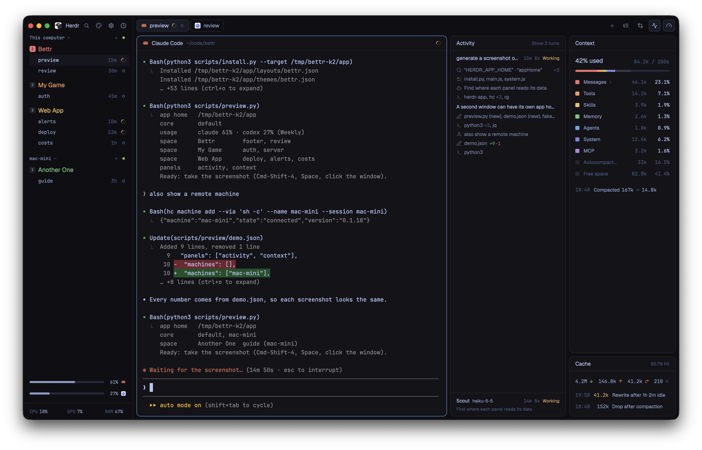

# Bettr for Windows

A Windows adaptation of [Bettr](https://github.com/dissimulate/bettr), a [Herdr](https://herdr.dev) layout for Claude Code and Codex.



## Features

- More compact spaces and agents sidebar.
- Claude Code and Codex usage limit bars.
- CPU, GPU and RAM display.
- Agent log/activity overview panel, running subagents list.
- Context breakdown, Cache overview and rewrite log.
- Own theme in `themes/bettr.json`. Light mode uses paper. Pick another in
  Settings at any time.

## Requirements

- Herdr 0.1.13 or later, Python 3.9 or later (`python3`).
- Claude Code or Codex. Other agents show in the sidebar only.
- On Windows, `python3` must resolve to a working interpreter. The official Python Install Manager provides this command.

## Develop and install on Windows

Edit this checkout and run the installer from the project directory to try changes in Herdr.

```powershell
python3 -I scripts/install.py --update --hooks
herdr-app do layout.switch --name bettr
```

The installer backs up replaced files and resolves Windows hook paths on the local machine.
Restart Codex CLI after the initial installation and use `/hooks` to review any hooks it marks for review.
The 5-hour allowance appears above the weekly allowance. Each bar shows the remaining percentage and time until reset.

## Install and update on macOS or Linux

```sh
python3 scripts/install.py --update --hooks
herdr-app do layout.switch '{"name":"bettr"}'
```

- The installer copies the layout, theme and mods to `~/.config/herdr-app/` and
  backs up replaced files to `~/.local/state/bettr/backups/`.
- `--hooks` merges the agent hooks into `~/.claude/settings.json` and
  `~/.codex/hooks.json`. `--agent claude|codex` does one agent only. New hooks
  load when an agent session starts or resumes. Codex asks you to review them
  with `/hooks`.
- Do not copy or rename the folders, also not from Herdr's gallery: the hooks
  call the mods by folder name. If they were copied, set up the hooks with
  `python3 -I ~/.config/herdr-app/mods/bettr-reporter/setup.py install`.
- To remove: switch layout, delete `layouts/bettr.json`, `themes/bettr.json` and
  `mods/bettr-*` in `~/.config/herdr-app/`, and remove the hooks that contain
  `mods/bettr-`.

**Remote machines.** Hooks run where the agent runs. The Layout dialog's
**Machines** section sets up or updates each connected machine. From a terminal:
`python3 scripts/install.py --update --reporter-only --hooks --remote <machine>`.
Usage bars show this computer's agents only.

## Data and privacy

- **Network:** only the Claude Code usage bars. They call
  `api.anthropic.com/api/oauth/usage` with your Claude Code login (Keychain on
  macOS, else `.credentials.json`), at most every 2 minutes, and less often after
  errors. This is not a stable public API.
- **Reporter:** runs from agent hooks, in Herdr terminals only. It publishes
  terminal labels and keeps state in `~/.cache/bettr/`. It never blocks the agent.
- **Activity** stores the prompt's first line (120 characters), file paths,
  search patterns, commands (300), agent text (800) and the final reply (2000).
  Values that look like credentials become `…`. Command output is never read.
- **Context** stores sizes and names only. **Subagents** store name, type, state,
  model, effort, times and task.

[`RECIPE.md`](RECIPE.md) is the build brief for the [Herdr gallery](https://herdr.dev/layouts/).

## Panel frames

Bettr draws the outer frame of every mod block under `panel-body`, including added
panels such as Org and Tracker. `PANEL_FRAME` in `mods/bettr-tabs/panel-mods.js`
sets the background theme token, border, and corner radius in one place. The panel
registry applies those native layout fields to existing and new blocks, including
Context and Cache, while keeping sizes, visibility, and other mod props.

Panel mods receive `layoutFramed: true` in their props. They should leave their
outer surface transparent and omit their own outer border and radius. Internal
headers, controls, and scroll areas remain the mod's responsibility. Bettr's own
panel mods draw only their contents. Other layouts can supply their own frames.
