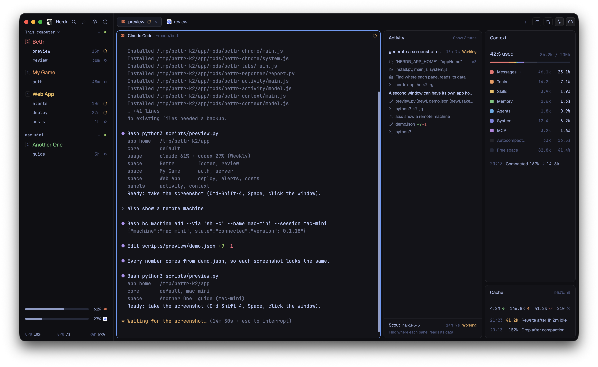

# Bettr

A [Herdr](https://herdr.dev) layout built for myself, you can use it if you want.



## Features

- More compact spaces and agents sidebar.
- Claude Code and Codex usage limit bars.
- CPU, GPU and RAM display.
- Agent log/activity overview panel, running subagents list.
- Context breakdown, Cache overview and rewrite log.
- Own theme in `themes/bettr.json`. Light mode uses paper. Pick another in
  Settings at any time.

## Requirements

- Herdr 0.1.13 or later, Python 3.9 or later (`python3`).
- Claude Code or Codex. Other agents show in the sidebar only.
- macOS or Linux. On Windows the hooks and usage bars do not work.

## Install and update

```sh
git clone https://github.com/dissimulate/bettr.git ~/.local/share/bettr   # update: git -C ~/.local/share/bettr pull
python3 ~/.local/share/bettr/scripts/install.py --update --hooks
herdr-app do layout.switch '{"name":"bettr"}'
```

- The installer copies the layout, theme and mods to `~/.config/herdr-app/` and
  backs up replaced files to `~/.local/state/bettr/backups/`.
- `--hooks` merges the agent hooks into `~/.claude/settings.json` and
  `~/.codex/hooks.json`. `--agent claude|codex` does one agent only. New hooks
  load when an agent session starts or resumes. Codex asks you to review them
  with `/hooks`.
- Do not copy or rename the folders, also not from Herdr's gallery: the hooks
  call the mods by folder name. If they were copied, set up the hooks with
  `python3 -I ~/.config/herdr-app/mods/bettr-reporter/setup.py install`.
- To remove: switch layout, delete `layouts/bettr.json`, `themes/bettr.json` and
  `mods/bettr-*` in `~/.config/herdr-app/`, and remove the hooks that contain
  `mods/bettr-`.

**Remote machines.** Hooks run where the agent runs. The Layout dialog's
**Machines** section sets up or updates each connected machine. From a terminal:
`python3 scripts/install.py --update --reporter-only --hooks --remote <machine>`.
Usage bars show this computer's agents only.

## Data and privacy

- **Network:** only the Claude Code usage bars. They call
  `api.anthropic.com/api/oauth/usage` with your Claude Code login (Keychain on
  macOS, else `.credentials.json`), at most every 2 minutes, and less often after
  errors. This is not a stable public API.
- **Reporter:** runs from agent hooks, in Herdr terminals only. It publishes
  terminal labels and keeps state in `~/.cache/bettr/`. It never blocks the agent.
- **Activity** stores the prompt's first line (120 characters), file paths,
  search patterns, commands (300), agent text (800) and the final reply (2000).
  Values that look like credentials become `…`. Command output is never read.
- **Context** stores sizes and names only. **Subagents** store name, type, state,
  model, effort, times and task.

[`RECIPE.md`](RECIPE.md) is the build brief for the [Herdr gallery](https://herdr.dev/layouts/).
