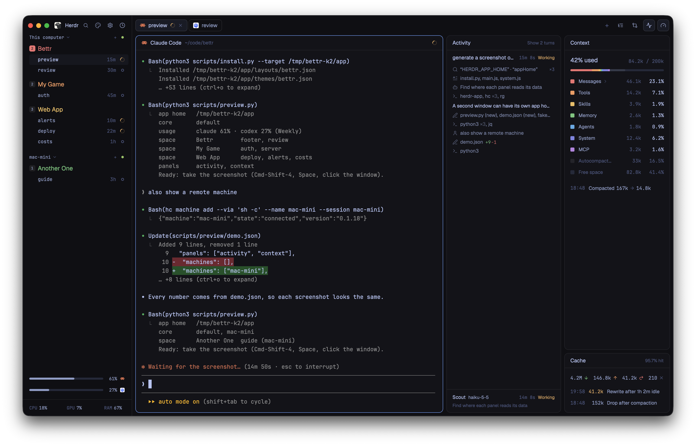

# Bettr

Spaces, agents, usage and system stats on the left; terminals in the centre;
Files, Changes, Activity and Context panels side by side on the right.

## What you see

- Theme `bettr` (`themes/bettr.json`) in dark mode,
  `paper` in light. Mods take every colour from `theme()`. Numbers, times and
  agent names in the terminal font
  (`settings().font_family`). Text sizes 15, 13, 12, 11.
- **Sidebar**, 268 px, on `chrome`:
  - Top row, 41 px (starts at 76 px on macOS): logo, name, then search, Layout
    (palette), Settings (`accent` dot when an update is ready), agent sort.
  - Spaces: a 15 px tab-count square and the name, in the space's colour
    (palette of seven). Agents: name, time in
    state, status (spinner, "Needs you" pill, dot, ring). Sub-agents with tree
    lines. One header per connected machine.
  - Usage, max 400 px: one 5 px bar per quota window, `muted` (`dim` after
    reset), percent on the right.
  - Footer, 41 px: `CPU 12%  GPU 3%  RAM 61%`. Over 70% `working`, over 90% `blocked`.
- **Tab bar**, 41 px: tabs, `+`, panel buttons (Files, Changes, Activity,
  Context). An open panel's button looks like the active tab.
- **Terminals**: 36 px `bettr-pane` headers, 10 px corners, 8 px gaps.
- **Right panel**, hidden until a button opens a panel. Open panels side by
  side, 8 px apart, 368 px each at first (280–1600 px in all).
  - Every header, on terminals and panels: 36 px, 14 px sides, 13 medium title.
  - Activity: 36 px header. Per turn: 36 px heading (prompt, run time, status),
    22 px steps (13 px Lucide icon, text, dim count), agent text, final reply.
    Working subagents below, max 200 px.
  - Changes: file list, diff, commit box. Worktrees below, max 240 px: one
    two-line row per worktree: folder and right-aligned branch, then green and
    red line counts and the size in MB at the right.
  - Context: 36 px header, `N% used`, 5 px bar in seven fixed colours, one 26 px
    row per kind, compaction log. Cache below: hit rate, read, write, rewrite
    and uncached totals, one line per miss.

## How it behaves

- Priority sort: blocked, done, working, idle, then latest change. A done agent
  you look at keeps its place until you leave it. Other choice: tab order.
  `agent.next` follows the shown order.
- Space: click selects, drag reorders, right-click opens the menu. Agent: click
  focuses. Sub-agent: click peeks. Chevron folds sub-agents.
- Usage: click a row to refresh. Hover a bar for reset time and age.
- Panel buttons toggle their own panel. Each space remembers its panels. The
  outer edge resizes the first open panel. The Layout dialog turns each button
  and the usage bars on or off, and its arrows set the panel order.
- Activity and Context follow the focused agent.
- A terminal header shows a yellow (`ansi3`) button at the far right, for
  example **Resume: Claude Code (opus-5-5)**, when a shell is in front and the
  terminal had a Claude Code or Codex session: after the agent exits, and after
  a core stop, crash or reboot gives the terminal a new shell. Hover shows the
  last prompt. A click types `claude --resume <id>` or `codex resume <id>` into
  that shell (`bettr-pane/resume.js`). Claude Code finds the session only from
  the folder it started in.
- Activity: newest turn open, older turns one row. Two or more older finished
  turns fold behind "Show N turns". Click a step for details, a cut message to
  read it as Markdown. Same-verb neighbours share a row (`grep ×3, cd ×2`). A
  working turn with no step for 15 minutes shows as Stopped.
- Context: click Messages, Tools, Skills or Custom agents for their parts.
  Cache fits its lines (double-click its heading to fit again), and hides when no
  agent is focused.
- Worktrees lists every worktree of the focused repo (`git worktree list`), and
  fits its rows the same way. Line counts include new files.

## Built from

- Root `row`, with `"theme": { "light": "paper", "dark": "bettr" }`: `sidebar`
  column (`brand` and `sidebar-footer` → `bettr-chrome`, `spaces` →
  `bettr-spaces`, `usage-limits` → `bettr-usage`) and `work` column (`tabs` →
  `bettr-tabs`, the active tab with `bettr-pane` headers, `panel`).
- `panel` → `panel-body` row: `files` (`bettr-files`), `changes`
  (column: `bettr-changes`, and `bettr-changes` with `section: "worktrees"`),
  `activity` (`bettr-activity`,
  `verbs` prop), `context` (column: `bettr-context`, and `bettr-context` with
  `section: "cache"`).
- Other mods add their own panel: `"panel": { "width": 900 }` or `"panel": true`
  in their `mod.json`, with `title` and an optional `icon.svg`. `bettr-tabs`
  finds them in the mods folder, shows a button and a switch in the Layout
  dialog, and writes a `mod-panel-<name>` block into the installed layout. An
  update keeps these blocks: `bettr-tabs/panel-mods.js`.
- `bettr-spaces`, `bettr-tabs` and `bettr-chrome` are clones of Herdr's
  `spaces`, `tabs` and `workspace-chrome`.
- `mods/bettr-reporter/` (Python, run by agent hooks) publishes the
  `bettr.activity`, `bettr.activity.<turn>`, `bettr.subagents` and
  `bettr.context` labels with `hc label`. The panels only read them (see each
  `SCHEMA.md`).
- Programs: `git rev-parse` (once per folder), `hc machine ls` (every 15 s), the
  footer's sampling (macOS `iostat`, `vm_stat`, `ioreg`; Linux `/proc`,
  `nvidia-smi`; Windows PowerShell), `python3` for machine setup, `codex
  app-server` on a usage click.
- Network: `mods/bettr-usage/report_usage.py` calls
  `https://api.anthropic.com/api/oauth/usage` with the Claude Code login token
  (macOS Keychain, else `.credentials.json`), at most every 2 minutes. Nothing
  else reaches the network.
- Files outside the mods: agent transcripts (read only), state and usage
  snapshots, and the reporter's bytecode, in `~/.cache/bettr/`.
- Shared state: `bettr.panels`, `bettr.panelOrder`, `bettr.agentSort`, `space.colors`. Icons: Lucide
  (ISC) via `scripts/lucide.py`, and Herdr's own.

## Watch out

- Install from a clone in `~/.local/share/bettr` with `python3
  scripts/install.py --update --hooks`, not by copying: without the hooks,
  Activity, Context and usage stay empty, and a copy of `layouts/` and `mods/`
  misses `themes/bettr.json`. Never rename a mod: the hooks call the mods by
  folder name. If the folders were copied anyway: `python3 -I
  ~/.config/herdr-app/mods/bettr-reporter/setup.py install`.
- An `on_size_change` element in a list row gets no height: measure outside the list.
- GPUI does not clip to rounded corners: round the end segments.
- A hidden block cannot show itself: its sibling must.
- Check a label's provider on every read: another agent in the same terminal
  leaves stale labels.
- Agent hooks, transcripts, the usage endpoint and the Codex app-server are not
  stable APIs.

## Done when

- `herdr-app check` passes for each mod; `herdr-app status` shows no errors.
- `setup.py status` (path above) prints `"state": "current"`.
- After a prompt, Activity shows the steps and reply, Context's total changes,
  and the usage bars update.
- A subagent shows under Activity while it works, and goes when done.
- Two open panels sit side by side; switching spaces restores each space's panels.
